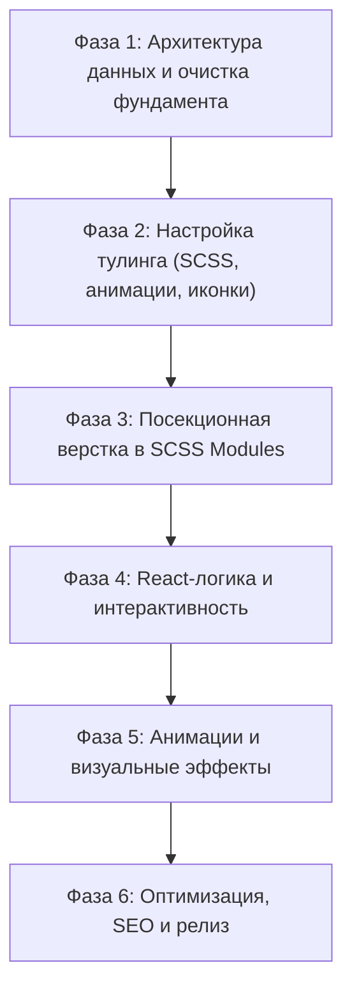

# 🗺️ Роадмап разработки: N-code Team Portfolio

План редизайна и разработки портфолио с переходом на **SCSS-модули**, подключением **библиотек анимаций** и созданием **чистой React-архитектуры**.

---

## 📊 Общая схема этапов



---

## 📌 Фаза 1. Архитектура данных и очистка фундамента
> **Цель:** отделить данные от представления до того, как начнется переписывание стилей и разметки. Это предотвратит переписывание JSX при изменениях дизайна.

- [x] **1.1. Исправление кодировки файлов**
  - Пересохранить файлы с поврежденным текстом в кодировке `UTF-8 без BOM`:
    - `src/sections/Contact/components/FormContactInput.jsx`
    - `src/sections/Footer/components/FooterLinks.jsx`
    - Комментарии в `Card.jsx`, `SectionsHeader.jsx`
- [x] **1.2. Создание слоя данных (`src/data/`)**
  - Вынести контент из компонентов в чистые структуры данных (JS-массивы объектов):
    - `projectsData.js` — список проектов (id, название, описание, теги, превью, авторы, демо/код ссылки).
    - `techStackData.js` — стек по категориям (Frontend / Backend / Tools) с иконками и процентами.
    - `whyUsData.js` — тезисы карточек сравнения (Solo vs Team), показатели статистики.
    - `workflowData.js` — шаги рабочего процесса (дизайн, фронтенд, бэкенд, запуск).
    - `contactsData.js` — ссылки на соцсети, контакты, Telegram.
- [x] **1.3. Универсализация базовых UI-компонентов (`src/components/`)**
  - **Button**: разделить логику на ссылки (`<a>`) и обычные кнопки (`<button type="submit">`), убрать жестко зашитую стрелку `<Arrow />` (сделать иконку опциональной).
  - **SectionsHeader**: привести к единому виду пропсы заголовков и бейджей секций.

---

## 🛠️ Фаза 2. Настройка тулинга (Стили и Стек)
> **Цель:** подготовить окружение для SCSS-модулей, анимаций и иконок.

- [x] **2.1. Подключение SCSS**
  - Установить современный компилятор Sass:
    ```bash
    npm i -D sass
    ```
- [x] **2.2. Архитектура SCSS (`src/styles/`)**
  - Создать модульную структуру базовых стилей:
    - `_variables.scss` (цветовая палитра: dark/neon, градиенты, шрифты, радиусы скругления, тени, z-индексы).
    - `_mixins.scss` (медиа-запросы для адаптива, flex/grid-центровки, стеклянный эффект glassmorphism, градиентный текст).
    - `_typography.scss` (базовые стили заголовков и текста).
    - `global.scss` (normalize/reset, кастомный скроллбар, подложка страницы).
  - Настроить алиасы в `vite.config.js` (например, `@styles`, `@components`, `@data`) для чистых импортов.
- [x] **2.3. Установка библиотек**
  - **Анимации:** `framer-motion` (стандарт для React: скролл, плавные появления, `AnimatePresence` для табов и фильтрации):
    ```bash
    npm i framer-motion
    ```
  - **Иконки:** `lucide-react` (быстрые древо-трясущиеся SVG-компоненты взамен тяжелого FontAwesome CDN):
    ```bash
    npm i lucide-react
    ```

---

## 🎨 Фаза 3. Посекционная верстка в SCSS-модулях
> **Цель:** переписать разметку и стили под новый дизайн с изолированными стилями `*.module.scss`.

- [x] **3.1. Layout и Навигация**
  - Добавить шапку сайта (`Header / Navbar`) с логотипом, якорными ссылками и мобильным бургер-меню.
- [x] **3.2. Секция Hero (`Hero.module.scss`)**
  - Главный экран команды: презентационный оффер, акцентные CTA-кнопки, визитки разработчиков.
- [x] **3.3. Секция About / Workflow (`AboutTeam.module.scss`)**
  - Карточки этапов работы команды (UI/UX, Frontend, Backend, Deployment).
- [x] **3.4. Секция TechStack (`TechStack.module.scss`)**
  - Категории стека, карточки технологий, уровни владения.
- [x] **3.5. Секция WhyUs (`WhyUs.module.scss`)**
  - Карточки сравнения «Один разработчик» vs «N-code Team».
  - Сетка показателей (StatsGrid).
  - Блок философии / терминал разработки (TypingDemo).
- [x] **3.6. Секция Projects (`Projects.module.scss`)**
  - Табы категорий фильтрации (Все, Fullstack, Frontend, Backend).
  - Адаптивная сетка карточек проектов с мокапами, тегами и ссылками.
- [x] **3.7. Секция Contact и Footer (`Contact.module.scss`, `Footer.module.scss`)**
  - Форма обратной связи с кастомными инпутами и селектором типа проекта.
  - Прямые контакты (Telegram, Email, телефон) и подвал сайта.

---

## ⚡ Фаза 4. React-логика и интерактивность
> **Цель:** оживить сайт, сделать его полностью динамическим и управляемым.

- [x] **4.1. Фильтрация проектов**
  - Состояние активного таба (`useState('Все проекты')`).
  - Фильтрация массива `projectsData` по тегу категории.
  - Плавная перегруппировка карточек через Framer Motion (`layout`).
- [x] **4.2. Обработка формы контактов**
  - Управляемое состояние формы (`useState`).
  - Валидация полей (имя, email, сообщение).
  - Состояния формы: `idle`, `success` экран обратной связи.
  - Отправка заявок (Telegram Bot API, EmailJS или Web3Forms).
- [x] **4.3. Управление Preloader'ом**
  - Логика плавного скрытия оверлея через `AnimatePresence` (`exit={{ opacity: 0 }}`) после готовности страницы.
- [x] **4.4. Мобильная навигация и якорный скролл**
  - Открытие/закрытие мобильного меню по клику на бургер.
  - Плавная прокрутка к нужным секциям.

---

## ✨ Фаза 5. Анимации и визуальные эффекты
> **Цель:** добавить интерактивности и сделать портфолио визуально запоминающимся.

- [x] **5.1. Scroll Reveal (появление при скролле)**
  - Анимация появления заголовков и карточек с помощью `whileInView` (Framer Motion) с задержкой (`delay`).
- [x] **5.2. Анимированные счетчики (`StatsGrid`)**
  - Плавный прирост чисел от 0 до целевых значений при попадании блока в зону видимости через `animate()`.
- [x] **5.3. Эффект печатной машинки / интерактивной консоли (`TypingDemo`)**
  - Поочередный вывод строк манифеста (хук на React или библиотека `typewriter-effect`).
- [ ] **5.4. Микроинтеракции и эффекты фона**
  - 3D-tilt или подсветка курсором карточек (spotlight effect).
  - Интерактивный фон Hero (частицы Canvas, бинарный код или градиентные сферы).

---

## 🚀 Фаза 6. Оптимизация, аудит и релиз
> **Цель:** максимальная скорость загрузки, идеальная мобильная адаптивность и деплой.

- [ ] **6.1. Очистка и оптимизация**
  - Удаление старого монолитного файла `style.css` (1000+ строк) после перехода на SCSS-модули.
  - Оптимизация изображений (WebP/AVIF, lazy loading).
  - Проверка в Lighthouse (цель: 95+ по производительности).
- [ ] **6.2. SEO и Метаданные**
  - Настройка Open Graph тегов для красивого превью при отправке ссылок в Telegram, VK и Discord.
  - Фавиконки и корректные `title` / `description`.
- [ ] **6.3. Деплой**
  - Проверка сборки (`npm run build`).
  - Деплой на Vercel, Netlify или GitHub Pages.

